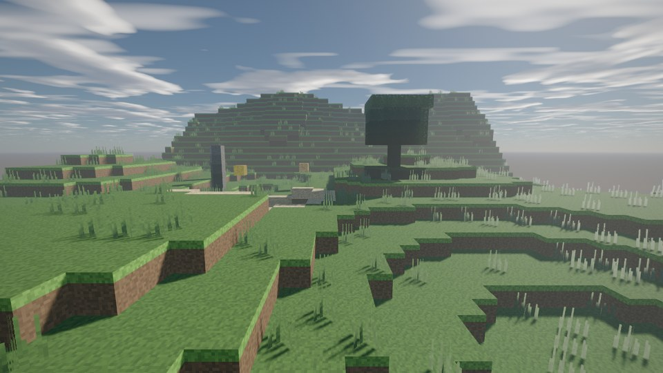
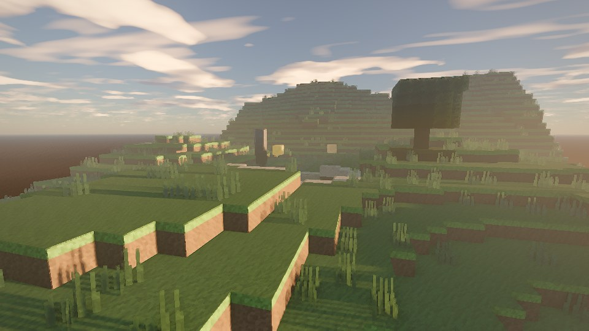
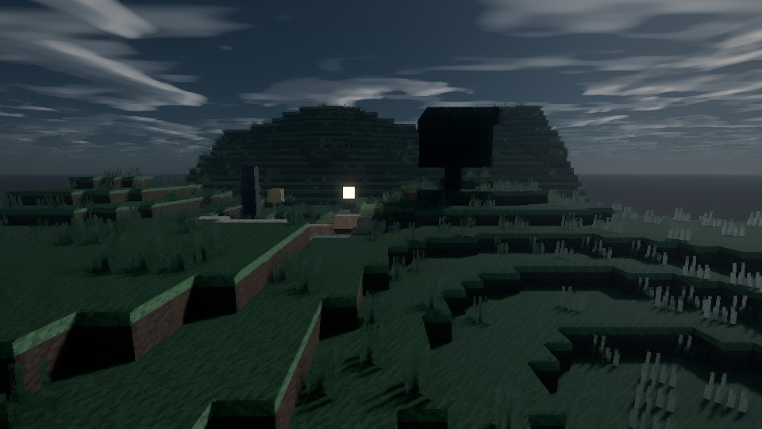
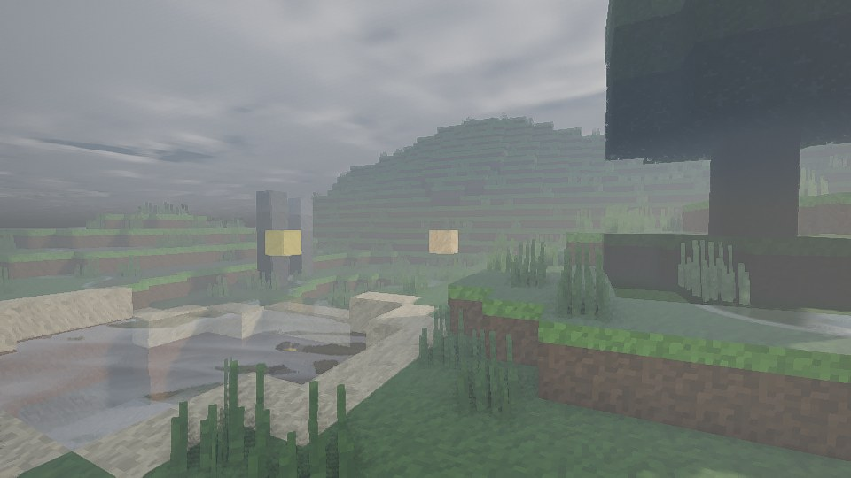

# Kestrel Shaders

A realistic Minecraft Java shader pack built to run well on **low-end PCs** (Intel UHD 620 /
Iris Xe, AMD Vega 8, GTX 750 Ti / 1050, RX 550) and on the **2020 M1 Mac mini**.

It aims for light that behaves consistently rather than brute-force effects:

- A **physical sky**. Sunrise colours, the blue noon sky, haze and twilight all come from one
  atmosphere model. That same model drives the sun's colour, the ambient light and the fog,
  so everything in the frame agrees.
- **Soft sun and moon shadows** that don't leak into caves. Coloured shadows through stained
  glass on HIGH.
- **Physically based surfaces**: glossy highlights, metals, rain that darkens and wets the
  ground, puddles that reflect, and [labPBR](https://github.com/rre36/lab-pbr/wiki) resource
  pack support.
- **Real water**: waves, refraction, depth colour, reflections and caustics.
- **Ambient occlusion**, **light shafts**, **two cloud layers**, **bloom**, **eye adaptation**,
  a night-vision colour shift, and **AgX filmic tonemapping**.
- **Temporal anti-aliasing with upscaling.** It renders at a lower resolution and rebuilds a
  sharp image, which is how it stays fast on integrated GPUs and on Retina/4K screens.

Every effect can be switched off, and switching an effect off removes its cost completely.

## Requirements

- Minecraft Java **26.3** (26.1.x and 26.2 should also work), Java 25
- **Fabric** (or NeoForge) with **Sodium + Iris**: the newest builds for your Minecraft
  version, from [Modrinth](https://modrinth.com/mod/iris)
- Video Settings → **Graphics API: OpenGL** (Iris doesn't run on the Vulkan backend; on 26.4
  and later pick "Prefer OpenGL")

OptiFine isn't supported.

## One-click setup (official Minecraft Launcher)

`KestrelShaders-Setup-<version>.zip` does everything for you: it installs Fabric for 26.3,
downloads Sodium and Iris from Modrinth (checksums verified), adds Kestrel switched on with
a quality profile you pick, and creates a **Kestrel Shaders** installation in the launcher
with its own game folder, so your other installations, mods and worlds are untouched.

1. Install the Minecraft Launcher, start it once, log in, then quit it.
2. Unzip the setup and run **Install on Mac.command** or **Install on Windows.bat**
   (`HOW-TO-INSTALL.txt` inside covers macOS and Windows security prompts).
3. Open the launcher, pick **Kestrel Shaders**, press Play.

Build it with `python3 tools/build_setup.py`. The manual routes below work too.

## Install on Windows

Pick one of these:

1. **Modrinth App**: create a new Fabric profile for your Minecraft version, add *Iris* and
   *Sodium*, then drop `KestrelShaders-<version>.zip` into the profile's `shaderpacks`
   folder.
2. **Prism Launcher**: create an instance, install Fabric, add Iris and Sodium from
   Modrinth, and put the zip in the instance's `shaderpacks` folder.
3. **Official launcher with the Iris installer**, if the installer supports your version.
   The `shaderpacks` folder is `%APPDATA%\.minecraft\shaderpacks`.

Then in game: Options → Video Settings → **Graphics API: OpenGL** → Shader Packs →
**Kestrel Shaders** → choose a profile (see below).

## Install on macOS (M1 Mac mini)

Use one of the same three routes. Two Mac-specific points:

- Use **native arm64 Java**, not Rosetta. The official launcher and the Modrinth App bundle
  it; in Prism, select or download an arm64 Java 25.
- The `shaderpacks` folder is `~/Library/Application Support/minecraft/shaderpacks` for the
  official launcher, or the instance folder for Prism / Modrinth.

**Set your display mode before anything else.** The Mac mini renders at your monitor's
backing resolution. A 4K monitor in the default "looks like 1080p" mode renders 3840×2160,
which is four times the pixels. Kestrel's auto render scale offsets this only partly, because
several buffers stay full size. For the best frame rate:

1. Run the monitor at a **1x mode** (1920×1080 on a 1080p monitor, 2560×1440 on a 1440p
   monitor), or
2. use a resolution mod such as retiNO / ResolutionControl+ or Sodium Extra's macOS option,
   if it supports your Minecraft version.

Choose the **MEDIUM** profile. If it's too slow, choose **LOW**.

## Which profile?

| Profile | For | Target |
|---|---|---|
| **POTATO** | Intel UHD 620 / HD 520, Radeon 610M, GT 1030 (DDR4) | 60 fps at 720p |
| **LOW** (default) | Intel Iris Xe, AMD Vega 8, GTX 750 Ti, RX 550, GT 1030 (GDDR5) | 60 fps at 1080p (auto render scale ~0.75) |
| **MEDIUM** | **M1 Mac mini**, GTX 1050 / 1050 Ti, RX 560, Radeon 680M | 60 fps at 1080p |
| **HIGH** | GTX 1060 / RX 580 and up | 60 fps at 1080p |

These are design targets, not measurements: nobody has benchmarked this pack on that
hardware yet. [docs/TESTING.md](docs/TESTING.md) has the test plan. If MEDIUM misses 60 fps
on your Mac, use LOW (it renders at about 0.75 scale with TAA upscaling). If LOW misses on
Iris Xe, use POTATO.

On a Mac, the heaviest settings (contact-hardening shadows, 24-step reflections, 12+ step
light shafts, top-quality AO) are clamped automatically. Turn on *Advanced → Allow Heavy
Effects on Mac* to lift the clamps.

## Performance tips

- Sodium is required; it does the heavy lifting for chunk rendering.
- Use render distance 6–8 chunks on integrated GPUs.
- Iris Xe needs **dual-channel** RAM to perform like Iris Xe.
- Laptops: plug in, and on hybrid laptops make Java use the dedicated GPU.
- AMD Polaris/Vega on Windows: use driver 22.7.1 or newer (the OpenGL rewrite).
- Intel 6th–10th gen: use the latest Intel legacy driver.
- **Render Scale** (Performance screen) is the biggest lever. Auto mode with Target Height
  810 or 720 makes almost any GPU faster.

## Troubleshooting

- **The pack won't load, or the screen is black.** On the shader-pack screen press Ctrl+D
  (try Cmd+D on macOS) to enable Iris debug mode, restart, load the pack again, and read
  `logs/latest.log`:
  - Windows: `%APPDATA%\.minecraft\logs\latest.log`
  - macOS: `~/Library/Application Support/minecraft/logs/latest.log`

  Iris writes the patched shaders to `<game folder>/patched_shaders/`, which helps map error
  line numbers back to the code.
- **"Iris cannot run when using Vulkan".** Switch Video Settings → Graphics API to OpenGL.
- **Keys.** F3+R reloads shaders (plain R works only with Iris debug options on). K toggles
  shaders. The shader-pack screen opens with the Iris key (I on 26.3, O on older Iris); check
  Controls if you rebound it.

## Known issues

See [docs/KNOWN_ISSUES.md](docs/KNOWN_ISSUES.md). The most important:

- Iris officially lists Apple Silicon Macs as unsupported (driver bugs aren't investigated
  upstream). Kestrel avoids every known Mac trigger, but it hasn't been tested on a real M1
  yet.
- No Distant Horizons or Voxy support.
- The pack needs Minecraft's OpenGL backend and will need a port when Mojang removes OpenGL.

## Preview

Renders of a procedural test scene from the development harness (`tools/render_test.py`,
Mesa software renderer). These are **not in-game screenshots**: they show the look of the
lighting, sky, water and post-processing.

## Documentation

- [Settings guide](docs/SETTINGS_GUIDE.md): every option, what it costs and what to pick
- [Architecture](docs/ARCHITECTURE.md): passes, buffers, units and budgets
- [Testing](docs/TESTING.md): in-game test plan, benchmark protocol, developer tools
- [Decisions](docs/DECISIONS.md) and [Verification](docs/VERIFICATION.md)

## Credits and license

Original code under the [MIT license](LICENSE). The published techniques and constants it
implements are credited in [CREDITS.md](CREDITS.md).
